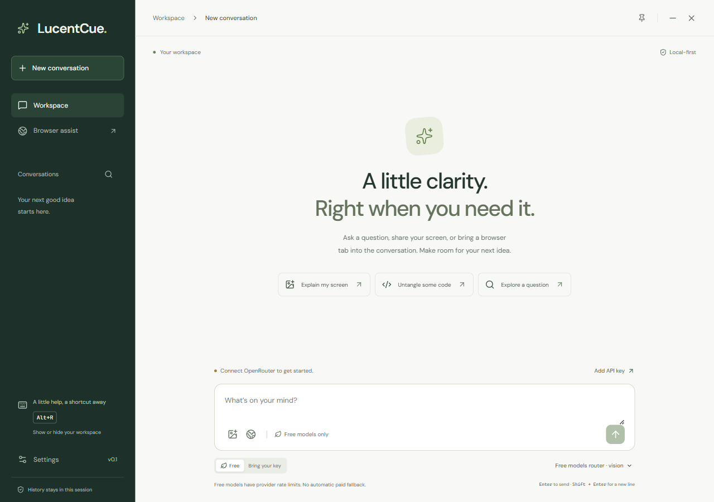

# LucentCue

[](https://github.com/ReaperXD67/lucentcue-desktop-ai/actions/workflows/ci.yml)

An open-source desktop AI assistant for questions, screenshot context, and practical browser help. Bring an OpenRouter, OpenAI, or Gemini key, keep your workspace a shortcut away, and choose exactly what you send.

**0.1.1 developer preview · MIT · Electron + React + TypeScript.** Locally packaged and installed on Windows; the next downloadable release targets `v0.1.1-preview.1`. [Published unsigned packages](https://github.com/ReaperXD67/lucentcue-desktop-ai/releases) are available for Windows, macOS, and Linux. See [release status](#release-status) and [0.1.1 preview notes](docs/RELEASE_NOTES.md).

For the installed Windows app, follow [Getting started](docs/GETTING_STARTED.md). [Windows testing](docs/WINDOWS_TESTING.md) records actual installation results separately from capture/privacy checks and live model access.



## What it does

- Streams Markdown answers with a Stop button, model selection, and conversation search.
- Offers a **Free** mode restricted to currently verified zero-price OpenRouter models, with no automatic paid fallback.
- Connects your own OpenRouter, OpenAI, and Gemini keys through Settings.
- Captures a display from the UI or a configurable shortcut, then lets you preview or remove the screenshot before sending it to a vision model.
- Opens a visible Chromium browser, reads page context for review, and fills a selected text field with text you approve. You submit in the browser.
- Provides configurable show/hide and screenshot shortcuts, optional always-on-top, a tray menu, and Markdown export.
- Offers optional OS capture protection on Windows/macOS, with clear platform limitations.
- Keeps conversations in memory by default; optional local history excludes screenshot images.

This is an original implementation inspired by a desktop-assistant workflow. No Pluely code or assets were copied and the supplied installer was not executed. See [research and provenance](docs/RESEARCH.md).

## Quickstart

Installed users can open **Browser assist → Set up assistant browser** to download optional Chromium. This uses the bundled Electron runtime and does not require system Node.js or npm. Chat and screenshots work independently of that download.

To run from source, use **Node.js 24 LTS** and npm. Run these commands in the project directory; PowerShell works on Windows:

```powershell
npm ci
npm run dev
```

For browser assistance during development, either use the in-app setup button or download Playwright's Chromium once:

```powershell
npm run browser:install
```

Chromium is a separate download and is not bundled into the desktop installer. Linux may need additional Playwright system libraries; see [browser setup](docs/BROWSER.md#setup).

`npm run dev` starts Vite and the Electron desktop app. Renderer changes reload during development; restart the command after editing desktop code. `npm run dev:ui` opens only an interface preview: it cannot store keys, take screenshots, control Chromium, or produce live answers.

For a production build and local desktop launch:

```powershell
npm run build
npm start
```

## Providers

1. Open **Settings → Connections**, choose a provider, paste its API key, and select **Save key**.
2. Choose **Free** for OpenRouter's zero-price catalog, or **Bring your key** to select OpenRouter, OpenAI, or Gemini and the models available to your account.
3. Select a model and send a question. Choose a model marked **vision** when attaching a screenshot.

There are no live model completions without a valid key. Keys are entered locally; do not put them in source files, `.env` files committed to Git, screenshots, or issue reports. Never embed a developer's shared key in a release.

**Free refers to eligible model inference, not unlimited usage.** OpenRouter quotas, account policies, provider capacity, and model availability still apply. LucentCue rechecks zero pricing before each free request and reports errors instead of switching to a paid model. Bring-your-key mode may incur provider charges. [OpenRouter's limits](https://openrouter.ai/docs/api_reference/limits) apply independently of LucentCue.

## Shortcuts and browser help

| Action | Default |
| --- | --- |
| Show / hide workspace | `Alt+R` |
| Capture screenshot | `Alt+Shift+S` |
| Send message | `Enter` |
| New line | `Shift+Enter` |

Change global shortcuts in Settings. If a shortcut is already taken, choose another; failed changes restore the previous bindings. Closing the workspace keeps the tray app running. Use **Quit LucentCue** in the tray menu to exit.

In **Browser assist**, open a site, read the current visible tab, review its text, and attach it to your question. To write into the page, select a discovered field and review the exact text before filling it. Filling triggers normal website input events, which can save drafts or cause other website behavior. The model cannot submit forms or perform browser actions itself. The browser has a separate persistent profile; it does not attach to your everyday browser. See [supported fields and boundaries](docs/BROWSER.md).

## Data and privacy

API requests run in Electron's main process and go directly to the selected provider. Prompts, attached screenshots, and attached page text leave the device when you send them; the provider's own data policy applies.

Provider keys are encrypted with Electron's OS-backed `safeStorage` when available. If secure OS storage is unavailable, including Linux's `basic_text` backend, keys remain in memory for the session and Settings shows a notice. The renderer receives only configured/not-configured status after saving.

History is **off by default**. When enabled, up to 40 conversations are stored as local JSON under Electron's application-data directory in `local/`; this text history and settings are not encrypted. Each saved conversation keeps recent text within 100 messages and 240,000 characters; the serialized history file is limited to 8 MB in UTF-8. Turning history off removes the saved file. You can also delete history in Settings. Screenshot images stay in session memory and are omitted from saved history and Markdown exports. Exported text is saved to the location you choose.

**Settings → Exclude window from screen capture** enables optional OS capture protection, off by default. Windows and macOS support the API; Linux does not. Protection is best effort: modern macOS apps using ScreenCaptureKit can ignore it, and other capture methods may still see the window. Test your actual sharing setup. LucentCue remains a normal discoverable desktop process. See [Electron's documented limitations](https://www.electronjs.org/docs/latest/api/browser-window#winsetcontentprotectionenable-macos-windows).

## Checks and packaging

```powershell
npm run format:check
npm run typecheck
npm test
npm run build
npm run test:desktop
```

`npm test` covers provider streaming/free-model rules, storage, browser-controller behavior, and browser setup. Optional real Chromium integration checks and their environment flag are documented in [browser verification](docs/BROWSER.md#verification). `test:desktop` exercises the desktop runtime; results are recorded below.

Set `LUCENTCUE_DESKTOP_FEATURES=1` for the optional real screenshot/browser smoke paths on a desktop session. The synthetic UI comparison is documented in [Windows testing](docs/WINDOWS_TESTING.md#synthetic-ui-comparison); it is separate from provider/network latency.

| Command | Output |
| --- | --- |
| `npm run pack` | Unpacked desktop app |
| `npm run dist:win` | Windows x64 NSIS installer |
| `npm run dist:mac` | macOS x64 / arm64 DMG targets |
| `npm run dist:linux` | Linux x64 AppImage / deb targets |

Build artifacts go to `release/`. Package on the target OS for release testing. Code signing, macOS notarization, and automatic updates are not configured. Optional Chromium setup is available in the app; browser binaries are downloaded separately.

The manual **Attach packages to draft preview** workflow transfers verified successful native-build artifacts and SHA-256 checksums to an existing draft prerelease. It keeps the release unpublished for maintainer review; see [CONTRIBUTING.md](CONTRIBUTING.md).

## Release status

For the published 0.1.0 baseline, [CI](https://github.com/ReaperXD67/lucentcue-desktop-ai/actions/runs/39045557690) and [native packaging](https://github.com/ReaperXD67/lucentcue-desktop-ai/actions/runs/39045558099) passed on Windows/macOS/Linux, and the packaged Windows browser helper passed. Current 0.1.1 source passes **90 tests, including 8 real Chromium tests, and 17 Electron smoke checks** on Windows. The optional smoke paths exercised a real OS screenshot through preview/removal and a visible local-fixture browser through read/attach/approved fill with no form submission. The 0.1.1 Windows NSIS build and per-user upgrade passed, and the installed app opened. New-version cross-platform CI and release assets remain pending.

The installed Windows app loaded the public OpenRouter free-model catalog without a key. No personal key was supplied. Native `Alt+R` successfully hid the installed 0.1.1 window; global restore and screenshot keypress checks remain pending. A separate harmless Electron fixture was visible with protection off and black with protection on under the tested Windows DXGI Desktop Duplication path. GDI was inconclusive; WGC and actual OBS/Zoom recorders remain untested. See the [scoped evidence](docs/WINDOWS_TESTING.md#capture-observations). macOS/Linux runtime behavior, signing/notarization, and live provider completions remain unverified.

0.1.1 fixes selected-tab reading, unchanged-shortcut re-registration, Copy answer through bounded trusted IPC, and oversized answers. Reusing completed message renders reduced a synthetic 4× CPU-throttled workload's median typing time from 16,543 to 549 ms and streaming time from 31,394 to 1,363 ms across five runs. These are local stress-comparison results, not network latency or installed-device guarantees; [method and limits](docs/WINDOWS_TESTING.md#synthetic-ui-comparison) are recorded separately.

## Contributing and next steps

Start with [CONTRIBUTING.md](CONTRIBUTING.md) and [AGENTS.md](AGENTS.md), run the relevant checks, and describe reproducible behavior without secrets or private screenshots. Keep the main README and affected guides aligned with significant changes. Architecture and trust boundaries are in [ARCHITECTURE.md](docs/ARCHITECTURE.md).

Planned work includes live transcription with clear recording consent, a hosted free-service relay with authentication and quotas, broader model capability checks, signed releases, and validation on macOS/Linux. These are roadmap items, not existing functionality.

For naming, useful GitHub topics, and future OpenRouter/Awesome Mac submissions, see [launch preparation](docs/LAUNCH.md). Discovery depends on a useful, maintained project; directory acceptance, search ranking, and stars are not guaranteed.

Licensed under [MIT](LICENSE). Third-party dependencies retain their own licenses.
