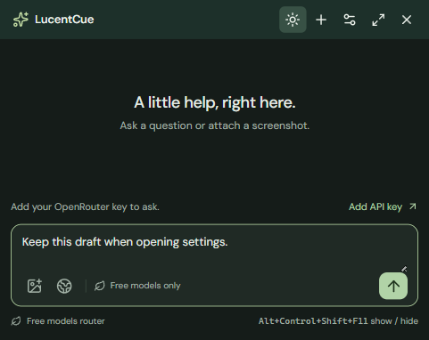

# LucentCue

[](https://github.com/ReaperXD67/lucentcue-desktop-ai/actions/workflows/ci.yml)

An open-source desktop AI assistant for questions, screenshot context, and practical browser help. Keep a small companion one shortcut away, open the full workspace when you need it, and choose exactly what you send to your own OpenRouter, OpenAI, or Gemini account.

**0.2.2 preview · MIT · Electron + React + TypeScript.** The [published preview](https://github.com/ReaperXD67/lucentcue-desktop-ai/releases/tag/v0.2.2-preview.1) has Windows, macOS, and Linux packages with SHA-256 checksums. The official Windows 0.2.2 installer upgraded the tested PC successfully; the installed companion passed theme, opacity, shortcut, and screenshot-preview checks. A desktop shortcut is available. Packages remain unsigned, and SignPath approval is pending. See [release status](#release-status), [signing application and setup](docs/SIGNING.md), and [preview notes](docs/RELEASE_NOTES.md).

For the installed Windows app, follow [Getting started](docs/GETTING_STARTED.md). [Windows testing](docs/WINDOWS_TESTING.md) records actual installation results separately from capture/privacy checks and live model access.



## What it does

- Starts in a compact companion for quick questions. Its Settings button opens the full workspace with connections, model selection, conversation search, and browser assistance.
- Switches between dark and light with a Sun/Moon button in either view, with Follow system available in Settings. Windows/macOS companion opacity is adjustable from 85–100%, with a save-and-preview action; the full workspace stays opaque.
- Shares the active conversation, draft, and attachments between companion and workspace; streams Markdown answers with a Stop button.
- Offers a **Free** mode restricted to currently verified zero-price OpenRouter models, with no automatic paid fallback.
- Connects your own OpenRouter, OpenAI, and Gemini keys through Settings.
- Captures a display from the UI or a configurable shortcut and attaches it directly to the composer for preview/removal before sending it to a vision model. Focus waits until React reveals the composer, including when the three-image limit rejects another capture.
- Opens a visible Chromium browser, reads page context for review, and fills a selected text field with text you approve. You submit in the browser.
- Provides configurable show/hide and screenshot shortcuts, optional always-on-top, an optional tray icon, and Markdown export.
- Offers optional OS capture protection on Windows/macOS, with clear platform limitations.
- Keeps conversations in memory by default; optional local history excludes screenshot images.

This is an original implementation inspired by a desktop-assistant workflow. No Pluely code or assets were copied and the supplied installer was not executed. See [research and provenance](docs/RESEARCH.md).

## Quickstart

Installed users can open **Browser assist → Set up assistant browser** to download optional Chromium. This uses the bundled Electron runtime and does not require system Node.js or npm. Chat and screenshots work independently of that download.

To run from source, use **Node.js 24 LTS** and npm. Run these commands in the project directory; PowerShell works on Windows:

```powershell
npm ci
npm run dev
```

For browser assistance during development, either use the in-app setup button or download Playwright's Chromium once:

```powershell
npm run browser:install
```

Chromium is a separate download and is not bundled into the desktop installer. Linux may need additional Playwright system libraries; see [browser setup](docs/BROWSER.md#setup).

`npm run dev` starts Vite and the Electron desktop app. Renderer changes reload during development; restart the command after editing desktop code. `npm run dev:ui` opens only an interface preview: it cannot store keys, take screenshots, control Chromium, or produce live answers.

For a production build and local desktop launch:

```powershell
npm run build
npm start
```

## Providers

1. Select the companion's **Settings** button to open the full workspace. In **Connections**, choose a provider, paste its API key, and select **Save key**.
2. Choose **Free** for OpenRouter's zero-price catalog, or **Bring your key** to select OpenRouter, OpenAI, or Gemini and the models available to your account.
3. Select a model and send a question. Choose a model marked **vision** when attaching a screenshot.

There are no live model completions without a valid key. Keys are entered locally; do not put them in source files, `.env` files committed to Git, screenshots, or issue reports. Never embed a developer's shared key in a release.

**Free refers to eligible model inference, not unlimited usage.** OpenRouter quotas, account policies, provider capacity, and model availability still apply. LucentCue rechecks zero pricing before each free request and reports errors instead of switching to a paid model. Bring-your-key mode may incur provider charges. [OpenRouter's limits](https://openrouter.ai/docs/api_reference/limits) apply independently of LucentCue.

## Shortcuts and browser help

| Action | Default |
| --- | --- |
| Show / hide LucentCue | `Alt+W` |
| Capture screenshot | `Alt+Shift+S` |
| Send message | `Enter` |
| New line | `Shift+Enter` |

Change global shortcuts in Settings. If a shortcut is already taken, choose another; failed changes restore the previous bindings. Upgrading replaces the former default `Alt+R` with `Alt+W` while preserving a custom binding. Closing the window keeps LucentCue running. Use **Quit LucentCue** in the app or tray menu to exit.

The companion is a small resizable window; the full workspace opens from its Settings control. Switching views preserves the conversation and unsent draft. You can turn **Show tray icon** off to reduce notification-area clutter and restore it from Settings. This does not hide LucentCue from Task Manager or the operating system; keep your configured show/hide shortcut available when the tray icon is off. On Windows, **Keep window on top** uses a level above the taskbar to retain native topmost status reliably.

The titlebar **Sun/Moon** button changes and saves the theme immediately. In **Settings → Appearance**, choose **Dark**, **Light**, or **Follow system**, adjust **Companion opacity**, then select **Save appearance** or **Save & preview companion**. Preview opens the small window so the change is visible; save any other Workspace edits first. Appearance and Workspace settings save separately. Opacity affects the whole companion, including text; the full workspace stays solid. Linux and the browser interface preview stay opaque. Recording privacy uses its separate OS protection setting.

In **Browser assist**, open a site, read the current visible tab, review its text, and attach it to your question. To write into the page, select a discovered field and review the exact text before filling it. Filling triggers normal website input events, which can save drafts or cause other website behavior. The model cannot submit forms or perform browser actions itself. The browser has a separate persistent profile; it does not attach to your everyday browser. See [supported fields and boundaries](docs/BROWSER.md).

## Data and privacy

API requests run in Electron's main process and go directly to the selected provider. Prompts, attached screenshots, and attached page text leave the device when you send them; the provider's own data policy applies.

Provider keys are encrypted with Electron's OS-backed `safeStorage` when available. If secure OS storage is unavailable, including Linux's `basic_text` backend, keys remain in memory for the session and Settings shows a notice. The renderer receives only configured/not-configured status after saving.

History is **off by default**. When enabled, up to 40 conversations are stored as local JSON under Electron's application-data directory in `local/`; this text history and settings are not encrypted. Each saved conversation keeps recent text within 100 messages and 240,000 characters; the serialized history file is limited to 8 MB in UTF-8. Turning history off removes the saved file. You can also delete history in Settings. Screenshot images stay in session memory and are omitted from saved history and Markdown exports. Exported text is saved to the location you choose.

**Settings → Exclude window from screen capture** enables optional OS capture protection, off by default. Windows and macOS support the API; Linux does not. Protection is best effort: modern macOS apps using ScreenCaptureKit can ignore it, and other capture methods may still see the window. Test your actual sharing setup. LucentCue remains a normal discoverable desktop process. See [Electron's documented limitations](https://www.electronjs.org/docs/latest/api/browser-window#winsetcontentprotectionenable-macos-windows).

## Checks and packaging

```powershell
npm run format:check
npm run typecheck
npm test
npm run build
npm run test:desktop
```

`npm test` covers provider streaming/free-model rules, storage, browser-controller behavior, and browser setup. Optional real Chromium integration checks and their environment flag are documented in [browser verification](docs/BROWSER.md#verification). `test:desktop` exercises the desktop runtime; results are recorded below.

Set `LUCENTCUE_DESKTOP_FEATURES=1` for the optional real screenshot/browser smoke paths on a desktop session. The synthetic UI comparison is documented in [Windows testing](docs/WINDOWS_TESTING.md#synthetic-ui-comparison); it is separate from provider/network latency.

| Command | Output |
| --- | --- |
| `npm run pack` | Unpacked desktop app |
| `npm run dist:win` | Windows x64 NSIS installer |
| `npm run dist:mac` | macOS x64 / arm64 DMG targets |
| `npm run dist:linux` | Linux x64 AppImage / deb targets |

Build artifacts go to `release/`. Package on the target OS for release testing. Trusted signing enrollment, macOS notarization, and automatic updates are not complete. Optional Chromium setup is available in the app; browser binaries are downloaded separately.

## Code signing policy

No release currently carries a LucentCue publisher signature. The owner reported submitting the free SignPath Foundation application on 18 October 2026; approval, signing configuration, and a verified pipeline covering the installed executable and installer remain pending. The application details and read-only Windows signature verifier are in [SIGNING.md](docs/SIGNING.md). No sponsorship or certificate approval is claimed. Signing does not guarantee acceptance by every device's Application Control policy.

The manual **Attach packages to draft preview** workflow transfers verified successful native-build artifacts and SHA-256 checksums to an existing draft prerelease. It keeps the release unpublished for maintainer review; see [CONTRIBUTING.md](CONTRIBUTING.md).

## Release status

0.2.2 ships the instant dark/light toggle, separate appearance save/preview controls, normalized shortcut-save fix, and composer visibility/focus fixes for shortcut screenshots. Formatting, type checks, **96 default automated tests**, the production build, and **26 local Windows desktop checks** pass. [CI](https://github.com/ReaperXD67/lucentcue-desktop-ai/actions/runs/39123365729), [native packaging](https://github.com/ReaperXD67/lucentcue-desktop-ai/actions/runs/39123368696), and [asset/checksum verification](https://github.com/ReaperXD67/lucentcue-desktop-ai/actions/runs/39123563024) passed at `d936e31`, including all 26 hosted Windows desktop checks. All five unsigned packages and checksums are [published](https://github.com/ReaperXD67/lucentcue-desktop-ai/releases/tag/v0.2.2-preview.1).

The official checksum-verified Windows installer completed normally on 18 October 2026 and produced installed version `0.2.2.0`. Actual installed checks passed Dark → Light → Dark, saving and previewing a visibly translucent 85% companion, reopening a solid workspace, Alt+W hide/restore with the tray icon off, and custom screenshot-shortcut attachment preview/removal without sending. Preferences survived the upgrade; the in-memory draft was restored after restart and preserved throughout the checks. A desktop shortcut targets the installed executable. Mac/Linux installation and GUI runtime remain unverified.

The owner reports submitting the free SignPath application; approval and a verified signing pipeline remain pending. No personal key was supplied, so live provider completions remain unverified. Earlier Windows source recording experiments cover only the tested FFmpeg DXGI path, not every recorder or the installed 0.2.2 application. [Windows testing](docs/WINDOWS_TESTING.md) separates source, installation, shortcut, and capture observations; [release notes](docs/RELEASE_NOTES.md) retain previous milestones and the [synthetic UI comparison](docs/WINDOWS_TESTING.md#synthetic-ui-comparison) records its workload and limits.

## Contributing and next steps

Start with [CONTRIBUTING.md](CONTRIBUTING.md) and [AGENTS.md](AGENTS.md), run the relevant checks, and describe reproducible behavior without secrets or private screenshots. Keep the main README and affected guides aligned with significant changes. Architecture and trust boundaries are in [ARCHITECTURE.md](docs/ARCHITECTURE.md).

Planned work includes live transcription with clear recording consent, a hosted free-service relay with authentication and quotas, broader model capability checks, signed releases, and validation on macOS/Linux. These are roadmap items, not existing functionality.

For naming, useful GitHub topics, and future OpenRouter/Awesome Mac submissions, see [launch preparation](docs/LAUNCH.md). Discovery depends on a useful, maintained project; directory acceptance, search ranking, and stars are not guaranteed.

Licensed under [MIT](LICENSE). Third-party dependencies retain their own licenses.
