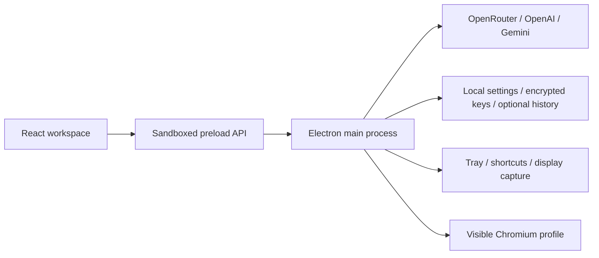

# Architecture

LucentCue is an Electron desktop application. React renders the workspace; a sandboxed preload bridge exposes a fixed API to the main process. Provider networking, OS integration, local files, and Playwright stay in the main process. The implementation is original TypeScript under the project's MIT license; [provenance research](RESEARCH.md) describes the upstream reference.

## Modules

| Path | Responsibility |
| --- | --- |
| `src/App.tsx` | Chat state, stream rendering, model selection, attachment review, conversation navigation, browser-assistance UI |
| `src/SettingsPanel.tsx` | Settings drafts, key entry/status, validation feedback, local-history deletion confirmation |
| `src/bridge.ts` | Desktop API selection and explicit browser-only interface preview |
| `shared/types.ts` | Shared settings, message, model, browser, and IPC contracts; default history disabled |
| `desktop/preload.ts` | Narrow `contextBridge` API; event subscriptions return cleanup functions |
| `desktop/main.ts` | Trusted IPC registration, app lifecycle/tray, shortcut rollback, screenshot capture/export, OS capture protection, request cancellation |
| `desktop/providers.ts` | Fixed provider endpoints, model-catalog filtering, free-pricing checks, OpenAI-compatible requests, incremental SSE parsing |
| `desktop/storage.ts` | Runtime input validation, serialized writes, atomic JSON replacement, OS-backed key encryption, image-free history |
| `desktop/browser.ts` | Visible Playwright Chromium, isolated persistent profile, page snapshots, approved field filling |
| `desktop/browser-installer.ts` | Explicit optional Chromium setup through Electron's bundled runtime, bounded helper lifetime, concurrent-click deduplication |
| `scripts/` | Vite/Electron development launcher and esbuild desktop bundles |
| `tests/` | Provider, storage, browser-controller, and desktop smoke workflows |

## Trust and request flow

The `BrowserWindow` uses context isolation, sandboxing, disabled Node integration, and normal web security. The main process checks that each IPC invocation comes from the configured top-level application frame. It denies new renderer windows, webview attachment, unexpected navigation, and renderer permission requests. A development renderer URL must be localhost. API destinations are fixed in `desktop/providers.ts`; renderer input cannot select an API host.

On send, the main process validates messages and captures a settings snapshot. At most one generation runs at a time. An `AbortController` cancels the provider request; request IDs keep stale chunks from updating another conversation. The SSE decoder preserves split UTF-8 characters and event records. It reports malformed, interrupted, empty, rate-limited, and provider-rejected streams. Catalog requests have a 20-second timeout and chat has a 120-second timeout. There is no silent retry loop or automatic paid-model fallback.

Free mode forces OpenRouter, reloads its catalog before each request, rejects models without confirmed zero values for all supplied pricing dimensions, and checks image support. Requests also set zero maximum prices and disable provider fallbacks. Bring-your-key mode uses the selected provider's OpenAI-compatible catalog/chat endpoint. Catalog capabilities vary by provider; non-OpenRouter vision labels use provider/model-family heuristics and still need live validation. A UI label does not guarantee that a particular account can access the model.

Keys are sent through the bridge only when a user saves or removes one. The main process retains them and returns boolean key status. Known keys are redacted from provider error messages. Key input is disabled in the browser-only preview; preview chat returns a desktop-required error rather than fabricated answers.

## Local state

Electron's `userData` directory contains `local/settings.json`, optional `local/history.json`, and `local/keys.json` when OS-backed credential encryption is usable. Keys use Electron `safeStorage`; Linux's insecure `basic_text` backend is treated as unavailable. In that case keys remain session-only and the UI receives a storage notice. The encrypted key file is OS/account-bound; it is not a portable secret export.

Settings and optional conversation text are plain JSON. Writes are serialized and use a temporary file plus rename. Local history is disabled by default. Saving settings with history disabled deletes its saved file; enabling history permits up to 40 conversations. A dedicated history sanitizer keeps recent text within 100 messages and 240,000 characters per conversation, independently of screenshot count/size. The exact serialized UTF-8 file is limited to 8,000,000 bytes before atomic replacement. Disk history and Markdown exports omit screenshot images; history includes a text marker when it fits the text budget. Session memory can contain images while the app is running. Shutdown waits briefly for pending writes and closes the assistant browser.

The renderer maintains active conversations in memory independently from the saved file. Screenshot capture temporarily hides the workspace, captures the selected display, restores the workspace, and returns a preview attachment; capture does not immediately call a model. Multi-display setups present a display choice.

The independent `captureProtection` setting defaults off and calls Electron's `setContentProtection` on Windows/macOS. Unsupported Linux builds disable the control. Settings changes restore prior protection if another save step fails; startup failures return a capability notice. The OS request is best effort: modern macOS ScreenCaptureKit consumers can capture protected windows, and no universal capture guarantee is made. See [Electron's platform behavior](https://www.electronjs.org/docs/latest/api/browser-window#winsetcontentprotectionenable-macos-windows). This does not hide the application process.

## Browser assistance

Playwright launches a visible Chromium persistent context under `userData/assistant-browser`. Its installed Chromium binary/cache is separate from the app package. This profile can retain website sessions; it is not the user's everyday Chrome/Edge profile. Closing it does not erase the profile.

The **Set up assistant browser** UI explicitly invokes `BrowserInstaller`. It resolves the bundled Playwright CLI and spawns the application's Electron executable with `ELECTRON_RUN_AS_NODE=1`, fixed `install chromium` arguments, no shell, and no visible console window. Installed users do not need a separate Node/npm installation. Repeated clicks share one task, downloads have a ten-minute timeout, shutdown terminates the helper, and success checks for a compatible executable. Chromium remains an optional network download rather than an installer payload. Development can also use `npm run browser:install`.

Only explicit UI actions open, read, fill, or close the browser. A snapshot returns bounded rendered text and ordinary editable fields, with existing field values omitted. Sensitive fields and embedded frames are excluded. Field references expire when the page changes or a fill completes. The model has no browser tools, script execution, click, sign-in, or submit capability. Filling dispatches normal input events and can trigger site behavior; users review the destination and exact text first. [BROWSER.md](BROWSER.md) explains limits and integration checks.

Screenshots and page text are untrusted references. The default prompt and request wrapper say so; this reduces instruction confusion but does not make model outputs trustworthy. The user decides what context to send and what text to put into a website.

## Build and validation

Vite produces the renderer in `dist/`; esbuild produces CommonJS main/preload bundles in `dist-desktop/`. Electron-builder packages those outputs with production dependencies into `release/`. Windows NSIS, macOS DMG, and Linux AppImage/deb configurations exist; configured targets do not imply those platforms have passed installation/runtime checks. Current outcomes are tracked in the [README release status](../README.md#release-status).

`npm test` uses mocked provider responses and temporary local storage. Browser-controller tests run without a browser by default; optional real Chromium checks use a temporary profile and local HTTP server. A separate desktop smoke workflow checks the Electron runtime. No live completion claims should be made until real provider keys have been used successfully. Packaging/signing and OS permission behavior need target-platform validation.

## Future shared service

A developer-sponsored free service is **planned, not implemented**. The existing `DesktopAPI.startChat` / `ChatRequest` boundary is a place to add a relay client, not an existing hosted backend or free entitlement. A future relay must authenticate users, protect the provider key server-side, apply per-user quotas and abuse controls, limit request sizes, enforce zero-price models and spending budgets, support cancellation, and disclose provider/data routing.

Never ship a shared key in Electron source, preload/renderer bundles, environment files distributed with the app, or release artifacts. Client obfuscation cannot protect a developer credential. Hosted access must remain separate from users' local provider keys and have clear quota/availability errors. Live transcription, audio capture, auto-updates, and autonomous browser actions are not current architecture features.
