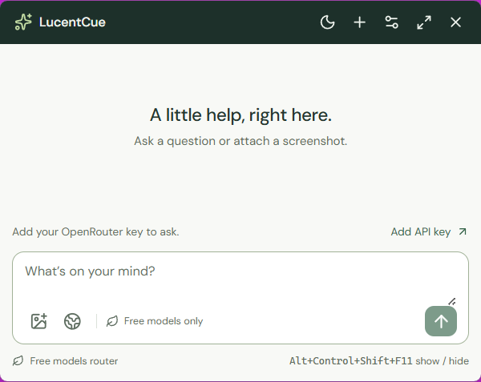

# Window capture privacy

LucentCue can request OS protection for its window while keeping it visible locally. The feature is available in the published 0.2.4 preview, which is installed on the tested PC; its capture privacy was not reverified after the upgrade. The dated evidence below covers earlier installed/source versions. This is ordinary window-content privacy for supported capture paths; the actual sharing or recording application determines what its recipient receives. Capture protection starts **off** and does not make screenshots, keyboard activity, or the application process undetectable.

## Enable and save the preference

1. Open **Settings**, then scroll to the **Workspace section** within the Settings panel.
2. Check **Exclude window from screen capture** and select **Save settings**. Wait for **Settings saved**; changing only the checkbox leaves an unsaved draft.
3. In a permitted test recording or call with harmless content, inspect the output from the exact sharing app and mode you intend to use. A local app view or native flag alone cannot establish the remote result.

The owner enabled and saved this setting in installed 0.2.2.0. A read-only Windows check at **22:14:19 IST on 18 October 2026** confirmed successful display affinity **`0x11`**, with the same installed app's native window visible and not minimized. Windows accepted the exclusion request then; this historical check does not establish the native state or recorder output after the 20 October upgrade to 0.2.4. The requested Scaler app full-screen stream and recipient view have not been tested. No agent changed the privacy preference or those sharing controls.

## Mechanism and platform limits

The main process calls Electron's `BrowserWindow.setContentProtection`. On Windows this requests `SetWindowDisplayAffinity` with `WDA_EXCLUDEFROMCAPTURE` (`0x11`); disabling protection uses `WDA_NONE` (`0x0`). The app applies its saved preference at startup and after companion/workspace transitions, and restores the prior value if saving fails. [Electron API](https://www.electronjs.org/docs/latest/api/browser-window#winsetcontentprotectionenable-macos-windows)

Windows 10 version 2004 and later support excluding the window while it remains displayed on the local monitor. Earlier Windows versions use the older no-content/black-window behavior. The request applies to an application's own top-level window and requires desktop composition. Microsoft explicitly does not guarantee strict content protection. [Windows display affinity](https://learn.microsoft.com/en-us/windows/win32/api/winuser/nf-winuser-setwindowdisplayaffinity)

The update takes effect on a later desktop composition, so an immediate capture can still include an earlier frame. On macOS, Electron requests `NSWindow` sharing protection, which modern ScreenCaptureKit consumers can ignore. Linux does not support this Electron protection API. Opacity, dark/light mode, pinning, and tray visibility are separate appearance/window preferences. [Electron limitations](https://www.electronjs.org/docs/latest/api/browser-window#winsetcontentprotectionenable-macos-windows)

## What a check proves

| Observation | Meaning |
| --- | --- |
| Saved checkbox and native affinity `0x11` | The app requested OS capture exclusion; this is not recipient-view proof |
| Native affinity `0x0` | This window currently has no display-affinity protection |
| Local window remains visible | The app is available on the local display; it says nothing about a recorder's output |
| Protected capture contains a black rectangle | The tested path hid the content; a visible black area can still reveal where a window was |
| Protected display capture reveals the known nonblack background | Evidence of clean window omission for that tested scene and capture path |
| Paired external OFF → ON → OFF captures | Evidence for that exact app, capture API, sharing mode, window, and machine |
| Capture error or timeout | Capture was unavailable or inconclusive; it does not establish excluded pixels |
| Screenshot taken by LucentCue | Its own window is hidden briefly before capture, independently of capture protection |

For an exact-path check, inspect the resulting saved recording or permitted test recipient's view, including the unprotected baseline and restored baseline. A known nonblack background distinguishes a clean omission from black redaction; black pixels over a black backdrop cannot distinguish those outcomes. Full-screen sharing, sharing one app/window, and sharing one browser tab are distinct paths. An exact-window WGC capture does not establish full-display sharing behavior. Scaler app full-screen sharing and its recipient view have not been validated, and an unrelated FFmpeg experiment cannot establish their output.

## Verified source results

The isolated 0.2.3 source harness passed on **18 October 2026**, including paired OFF → ON → restored OFF **display-capture stills** through both DXGI and Windows.Graphics.Capture. Unprotected baselines showed the app; protected captures revealed **100% of the known magenta background**, with 0% app palette and 0% black. This demonstrates clean omission in that 600 × 477 app crop for those tested paths, while the app's native visibility and internal renderer paint were checked separately.

| Protection OFF | Protection ON |
| --- | --- |
|  |  |

Isolated source profile, 600 × 477 capture crop, temporary test shortcut, and an owned magenta background. These are synthetic app-only tests, not the Scaler stream or an installed protection-on check. Both images were visually inspected.

A separate nine-stage **DXGI video** check passed all 54 frames over a black backdrop: 24 unprotected/restored frames showed app UI, and 30 protected frames showed black background. Native flags were checked before and after each capture. It covered companion/workspace transitions, hide/show, and renderer reload. Black-backdrop evidence alone cannot distinguish omission from redaction; the colored display stills above do. The WGC display test used still frames, not video.

Exact-window WGC is a distinct path. Its source OFF/restored baselines showed the app, but the protected attempt delivered no complete frame and was classified **capture unavailable**, not successful pixel exclusion. Complete WGC stills were collected before intentionally stopping the owned FFmpeg process; intentional termination is recorded separately from normal exit or a timeout. The [Windows test record](WINDOWS_TESTING.md#capture-observations) gives the method and limits. No source test used a personal key or provider completion.

## Installed app and target sharing path

The tested PC now runs **0.2.4.0**. No installed 0.2.4 capture-affinity or recorder-output check was completed during the upgrade; the following installed capture results are historical 0.2.2 evidence from 18 October 2026.

Before the owner enabled protection, a read-only installed 0.2.2 exact-window WGC probe captured one complete 160 × 100 RGB frame with no black pixels; native affinity stayed `0x0`. Its fixed-size collector intentionally stopped FFmpeg after the complete frame, with no image persisted or uploaded. This is the historical unprotected window baseline; the later native `0x11` check above confirms the enabled request. Protected capture pixels and the Scaler full-screen stream remain unverified. No screenshot was sent to the model during these checks.

After enabling protection in installed 0.2.2, the exact-window WGC probe received **0 of 48,000 required RGB bytes** within a 10-second frame deadline. The native affinity remained `0x11`, the window stayed visible, and its verified owner stayed stable before and after the attempt. The owned FFmpeg process was cleaned up with actual exit `-1`; no complete frame or pixel statistics were available. This is **capture unavailable / inconclusive for pixels**, not proof of universal exclusion or the Scaler recipient's view. No image was persisted or uploaded, key read, or model request made.

Pluely's inspectable historical code enables Tauri content protection, whose Windows dependency uses the same affinity mechanism. Its v1 product is closed source, so that public code does not prove the supplied binary's full implementation or universal exclusion. See the immutable [source comparison](RESEARCH.md#pluelys-inspectable-capture-mechanism).
