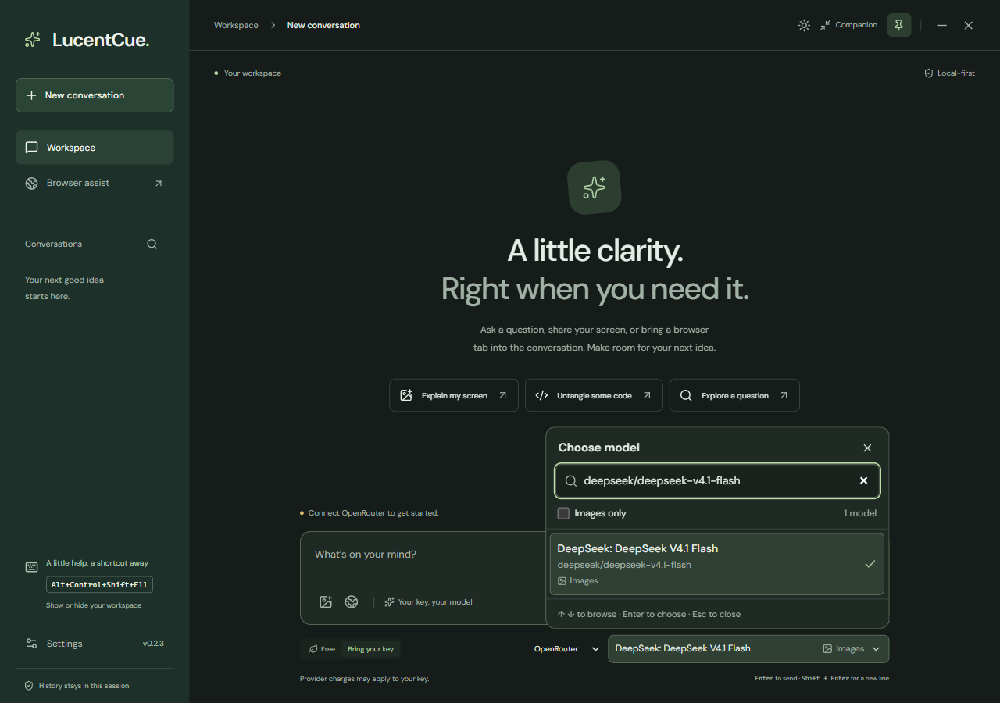

# Get started with LucentCue on Windows

Use the desktop application for real answers, screenshots, and browser assistance. The web interface preview cannot perform those actions. The published and installed 0.2.2 preview includes a compact companion, a full workspace, and direct appearance controls. The searchable model picker is in 0.2.3 source; its packages and installed verification are pending. Source passes 96 default automated tests and 30 isolated Windows desktop checks. [WINDOWS_TESTING.md](WINDOWS_TESTING.md) separates these results. No personal key was supplied during testing, so live model answers have not been verified.

## Install or upgrade

Download the Windows installer and `SHA256SUMS.txt` from the [0.2.2 preview release](https://github.com/ReaperXD67/lucentcue-desktop-ai/releases/tag/v0.2.2-preview.1). The installer is unsigned. On a device whose policy permits installation, open LucentCue from the Start menu afterwards. Installed users do not need Node.js, npm, or a source checkout.

On 18 October 2026, the official checksum-verified 0.2.2 Windows installer completed with exit code 0 on the tested PC. The installed executable reports `0.2.2.0` and opens the compact companion. Open the **LucentCue** desktop shortcut or **Start → LucentCue**. Actual installed theme switching, 85% companion opacity, solid workspace, **Alt+W** hide/restore with the tray off, and the configured capture shortcut's attachment preview/removal passed; no question was sent. Existing custom shortcuts are preserved. Detailed results are recorded in [Windows testing](WINDOWS_TESTING.md).

Windows had refused the earlier 0.2.0 installer with **“An Application Control policy has blocked this file.”** The later official 0.2.1 and 0.2.2 packages were accepted without changing security policy, trust stores, file metadata, or their published filenames. They remain unsigned; this outcome does not guarantee acceptance on other devices. If a device refuses an installer, obtain a build signed by a certificate trusted by its policy or administrator-approved deployment.

The per-user executable is `%LOCALAPPDATA%\Programs\LucentCue\LucentCue.exe`. For an upgrade, use **Quit LucentCue** in the app or tray menu first, then run the newer official installer and choose the same installation location. There is no automatic updater. If local history matters to you, export the conversations you want to keep before changing versions.

## Companion and workspace

LucentCue starts as a small companion for questions and answers. Select its **Settings** button to open the full workspace and Settings. The full workspace contains connection setup, model selection, history controls, browser assistance, and exports. Return to the companion when you want a smaller window. Both views share the active conversation, unsent draft, and attachments; switching views does not send a message.

### Appearance

The header's **sun/moon button** switches immediately between Dark and Light and saves the choice in both the companion and workspace. **Follow system** remains available in **Settings → Appearance**. Dark is the default.

For translucency, open **Settings → Appearance**, set **Companion opacity**, and select **Save & preview companion**. This saves only appearance and opens the small window so you can see the effect. **Save appearance** saves the same preferences without leaving Settings. Windows/macOS allow 85–100% whole-window opacity: 85% is gently translucent; 100% is solid. Text fades with the window. The full workspace stays solid, so dragging the slider while editing Settings does not fade that view. Linux and browser previews do not support opacity.

Appearance is saved separately from Workspace changes. If you have an unsaved shortcut, pin, privacy, or other Workspace change, save it with **Save settings** before using **Save & preview companion**; preview is disabled until then so those drafts are not discarded. You can still use **Save appearance** or the header theme button without saving unrelated edits.

These controls are included in the published and installed 0.2.2 preview. The actual installed Windows app passed sun/moon switching and saving/previewing 85% companion opacity while the full workspace stayed solid. Older 0.2.1 uses **Settings → Appearance → Save settings**, then **Companion** to see opacity, and has no header theme button; upgrade for the simpler controls.

For free trusted Windows signing, the owner reports having submitted the [SignPath application](SIGNING.md); approval, pipeline setup, and a signed installer remain pending. The successful unsigned 0.2.2 installation is separate from that signing work.

## Connect your personal OpenRouter key

You can browse OpenRouter's public free-model catalog without a key. This was observed in the installed preview, including **Free Models Router · vision**. Generating answers still requires a personal key; catalog loading is not a completion test. You can leave key setup for later.

1. Sign in to [OpenRouter's key settings](https://openrouter.ai/settings/keys) and create a dedicated personal key for LucentCue. Review its account and spending controls.
2. Select the companion's **Settings** button, then choose **Connections → Provider → OpenRouter**. Paste the key into the password field and select **Save key**. Enter it directly in the app; never put it in chat, a bug report, source code, or Git.
3. Confirm **Key configured**, then close Settings. This confirms local storage, not that a provider has accepted the credential.
4. Keep **Free** selected below the composer and choose **Free models router** (`openrouter/free`). Send a harmless question such as “Reply with one short sentence about trees” to check live access.

The [free router](https://openrouter.ai/docs/cookbook/get-started/free-models-router-playground) chooses an available compatible free model. LucentCue checks zero pricing before each free request and does not fall back to a paid model. **Bring your key** mode can use paid models; stay in **Free** for free-model routing.

Free access is limited by [OpenRouter's current quotas](https://openrouter.ai/docs/api_reference/limits), account policy, and provider capacity. Limits and account tiers can change. A 429 means wait before retrying; changing client keys does not create extra quota. If the catalog or router is unavailable, retry later or select another currently listed free model.

### Paid OpenRouter for screenshot questions

For a budget starting point, choose **DeepSeek V4.1 Flash** for image questions and text answers. DeepSeek documents its native [image understanding](https://api-docs.deepseek.com/guides/vision/). **GPT-6 Luna** is an alternative if you prefer an OpenAI model. Neither recommendation has been validated with live paid completions in LucentCue; quality depends on the question and image readability.

| Use | Exact OpenRouter model | Listed input / output per million tokens |
| --- | --- | --- |
| Budget starting point | [`deepseek/deepseek-v4.1-flash`](https://openrouter.ai/deepseek/deepseek-v4.1-flash) | From $0.04 / $0.144 |
| GPT alternative | [`openai/gpt-6-luna`](https://openrouter.ai/openai/gpt-6-luna) | $0.10 / $0.50 standard short-context |

Rates were checked on **18 October 2026**. DeepSeek's starting rates are from its cheapest listed provider; other providers charge more. LucentCue does not pin a provider, sort routes by price, or impose a paid price cap, so those starting rates are not a guaranteed bill or guaranteed saving over Luna. Image tokens, conversation length, reasoning, and caching also affect costs. Recheck the linked provider prices before use.

1. Save your **OpenRouter** key using the connection steps above. For an initial trial, optionally set a **$1 key limit** in [OpenRouter's key settings](https://openrouter.ai/settings/keys); LucentCue does not configure that limit.
2. In the full workspace below the composer, select **Bring your key**, choose **AI provider → OpenRouter**, then select **DeepSeek V4.1 Flash** with the exact model ID above. In 0.2.3, open **AI model**, search `deepseek/deepseek-v4.1-flash`, and select the result marked **Images**. Mode, provider, and model choices save immediately.
3. Capture a screenshot, review it, type your question, and send. **Bring your key** here uses your OpenRouter key and credits; it does not require a separate DeepSeek or OpenAI key. Switch back to **Free** whenever you want the zero-price catalog.

Use **New conversation** for each unrelated image: follow-ups resend the active conversation, including earlier screenshots. For shorter answers, ask “Give the answer first, followed by a brief explanation. Say if any text is unreadable.” You can append this preference under **Settings → Workspace → Advanced instructions** while preserving the existing safety instructions. A concise prompt is a preference, not a billing cap: LucentCue has no hard output-token, reasoning-effort, or paid-spend controls.

The 0.2.3 model picker shows readable model names and IDs in Dark and Light. **Images only** filters image-capable models; **Free** labels describe zero-price eligibility in the current catalog. Search by name or ID, browse with ↑/↓, select with Enter, or close with Escape. Clicking outside closes the picker. Model changes do not send your question. The picker is unavailable during generation or a provider/catalog change, so models from a previous provider cannot be selected accidentally. Older 0.2.2 uses the native model dropdown.

App-only screenshot from the isolated 0.2.3 test profile; the shortcut shown is a temporary test binding, not the default Alt+W. No personal key or live model answer was used.

## Shortcuts and everyday controls

| Action | Default | Scope |
| --- | --- | --- |
| Show or hide LucentCue | `Alt+W` | Global, while LucentCue is running |
| Capture a display | `Alt+Shift+S` | Global, while LucentCue is running |
| Send a message | `Enter` | Message input focused |
| Insert a new line | `Shift+Enter` | Message input focused |
| Hide the current window | `Alt+F4` | Standard Windows close action; does not quit LucentCue |

Change the two global shortcuts in **Settings → Workspace**, then select **Save settings**. Use a modifier and key, such as `Control+Shift+Space`. If another app owns the combination, choose another; failed changes restore the previous bindings. When upgrading, the old default `Alt+R` becomes `Alt+W`; custom bindings are kept. New conversation, Search conversations, Export, and Stop generating are UI buttons without dedicated app shortcuts.

The titlebar **X** hides the window; **−** minimizes it. Click the tray icon to show/hide it, or use the tray menu's **Open companion**, **Open workspace**, **Take screenshot**, and **Quit LucentCue**. The pin button or **Keep window on top** setting controls topmost behavior. On Windows, pinning uses a level above the taskbar because the default floating level could immediately lose native topmost status on the tested system.

Turn **Settings → Workspace → Show tray icon** off and select **Save settings** if you want less notification-area clutter. `Alt+W` hides the window; it does not quit the running app or remove its tray icon by itself. Keep your configured show/hide shortcut available, or launch LucentCue from Start to reopen it. **Quit LucentCue** in the app exits even when the tray icon is off. This setting does not conceal the app from Task Manager, process lists, or operating-system monitoring.

## Screenshots and browser assistance

Use the screenshot button or capture shortcut, select a display if asked, and review its attachment thumbnail. Remove it with its **X** before sending if it contains anything private. Choose a model marked **vision**. Capturing alone does not send the image; sending a message does. Images are omitted from saved history and Markdown exports.

The global shortcut restores LucentCue and attaches the screenshot directly to the text box area; type your question beside it and select **Send**. Up to three screenshots can be attached. LucentCue briefly hides its own window before capture so its UI is omitted from that image. The capture path uses an in-memory image, without writing an image file or placing it on the clipboard. This does not make capture undetectable to the operating system or monitoring software, and OS prompts or indicators may still appear. In 0.2.2, shortcut delivery also closes an overlapping Settings/Browser panel and focuses the composer so the attachment can be reviewed immediately.

In **Browser assist**, select **Set up assistant browser** once to download optional Chromium. This uses the bundled desktop runtime. Open a website, select its tab in the visible Chromium window, and choose **Read page**. Review the text, then **Attach to question** if you want it sent with your message. To write into a page, choose a supported field, review the exact text, and select **Fill selected field**. You submit in Chromium. Website input events may save drafts or trigger site behavior. See [browser boundaries](BROWSER.md).

## Privacy settings and limits

History and capture protection start **off**. **Save history on this device** stores recent conversation text locally without encryption; turning it off and saving removes saved history. **Delete saved history** has a second confirmation. Provider keys use OS-backed encryption when available; otherwise the app shows a notice and retains keys only for the session.

**Exclude window from screen capture** requests best-effort OS protection on Windows/macOS. Save the setting and test your actual capture setup with harmless content. Linux does not support it, and macOS ScreenCaptureKit can ignore it. It does not hide LucentCue from Task Manager, people looking at the screen, cameras, or every recording method. [Windows testing](WINDOWS_TESTING.md) distinguishes API state from observed capture results.

Your key authenticates an account; local encryption does not make provider usage anonymous. Sent prompts, screenshots, and attached page text go to the provider. OpenRouter says prompt/response retention is opt-in but request metadata is stored; underlying providers have their own policies. Review [OpenRouter privacy settings](https://openrouter.ai/settings/privacy), [data collection](https://openrouter.ai/docs/guides/privacy/data-collection), and [provider policies](https://openrouter.ai/docs/guides/privacy/provider-logging) before sending sensitive material.
